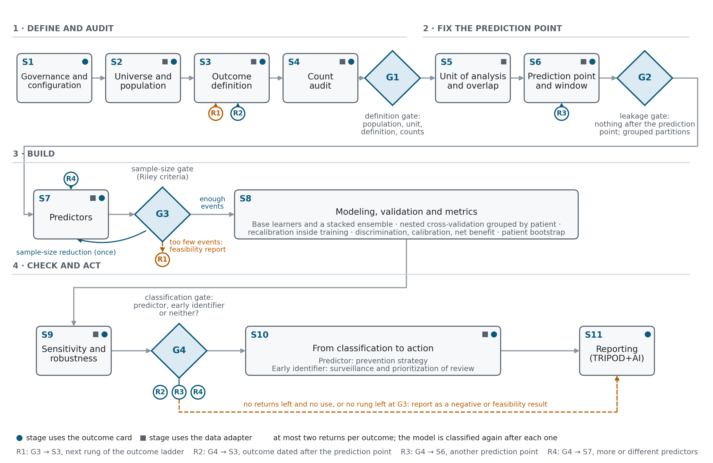

# Staged framework for clinical prediction models

**A framework for building predictive models of maternal, perinatal and neonatal deaths that support the design of prevention strategies and action plans in health institutions.**

Doctoral thesis, Department of Systems Engineering, Universidad del Norte (Barranquilla, Colombia). Author: Emmanuel Gutiérrez Jiménez. Supervisor: José Duván Márquez Díaz.

Spanish version: [`README_es.md`](README_es.md). Models that apply the framework and their status: [`models.md`](models.md).

> **Nomenclature.** In English the stages are **S1 to S11** and the gates **G1 to G4**; in Spanish they are **E1 to E11** (*etapas*) and **P1 to P4** (*puertas*). Returns are **R1 to R4** and the classification criteria **C1 to C4** in both languages.

## 1. The problem it solves

A model with good discrimination does not necessarily predict. When the outcome is recorded for a whole hospitalization (for example, from discharge codes), a model can reach a high AUROC because it **recognizes an event already under way** at the prediction time, not because it anticipates it. Such a model is of no use for prevention. An outcome may also have so few events that any model overfits, or information recorded after the prediction time may leak into the predictors.

The framework takes any adverse outcome (maternal, perinatal or neonatal) from its definition to reporting, with explicit decisions and **gates** that stop the process until their criteria are met. It ends by classifying the fitted model as:

- **Predictor:** anticipates events that have not yet happened. Suited to **prevention**.
- **Early identifier:** recognizes events already under way. Suited to **surveillance and prioritization of review**, not to prevention.
- **Insufficient signal:** does not reach the thresholds for a justifiable use (*neither* in the figure and in the Cureus article).

*Figure. Eleven stages in four blocks and four gates (S = stage, G = gate). A dot marks the stages that use the outcome card and a square those that use the data adapter. R1 starts at the sample-size gate; R2 to R4 start at the classification gate. The sample-size reduction refits once a model that meets the classification gate but fails the sample-size gate.*

## 2. Three layers

The framework separates what never changes from what depends on the outcome or the data source, so a new outcome or a new database does not require rebuilding the method.

| Layer | Contains | Changes when |
|---|---|---|
| **Core** | Stages, gates, validation, metrics, classification rule, reporting | Never between outcomes |
| **Outcome card** | Rung on the outcome ladder, population, event definition and timing, prediction point, predictors, reduced predictor set, primary learner, sensitivity analyses, expected counts | Each outcome has its card |
| **Data adapter** | Code that turns a data source into the **contract table** | Each data source has its adapter |

**Contract table.** The core reads only a table with one row per unit of analysis and fixed columns: `unit_id`, `group_id` (grouping unit never split between training and test, for example the patient), `t0` (time zero), `t_pred` (prediction point), the main and sensitivity labels, each predictor with an indicator of whether it was measured, and `period` (calendar period or coding era).

**Decision log.** Every decision is recorded with its date, the options considered, the option chosen, the reason, the type of reason (clinical, methodological or technical) and who validated it. It is not a stage: it runs across the whole process and makes every choice auditable.

## 3. Overview

| Block | Stage or gate | Question it answers |
|---|---|---|
| Define and audit | S1 Governance and configuration | What is fixed before anything runs? |
| | S2 Universe and population | Which units can be studied? |
| | S3 Outcome definition | What counts as an event, from which sources, and when did it happen? |
| | S4 Count audit | How many events, where, when, with what overlap? |
| | **G1 Definition gate** | Are population, unit and definition fixed, and do the counts reproduce? |
| Fix the prediction point | S5 Unit of analysis and overlap | What is one record, and what must stay on one side of a split? |
| | S6 Prediction point and window | When is the prediction made and what information may it use? |
| | **G2 Leakage gate** | Does nothing after the prediction point enter, and are partitions grouped? |
| Build | S7 Predictors | Which variables, with what coverage and limits? |
| | **G3 Sample-size gate** | Are there enough events for the candidate parameters? |
| | S8 Modeling, validation and metrics | How well does it work, with what uncertainty? |
| Check and act | S9 Sensitivity and robustness | Does it survive other reasonable choices, including criteria C1 to C4? |
| | **G4 Classification gate** | Predictor, early identifier or insufficient signal? |
| | S10 From classification to action | What use fits the class, and is it fair across subgroups? |
| | S11 Reporting | What is delivered, and how? |

**Central rule: no model is fitted before gate G3 is passed.** Everything that defines the problem (population, outcome, prediction point, predictors) is fixed before any performance result is seen, so those decisions cannot adapt to the results [1–3].

## 4. The stages

### S1. Governance and configuration

- **What is done.** The data source and its version, access and data use agreement, random seed, software versions, reference counts that must reproduce and the publication rule (aggregate outputs only, no identifiers, small cells suppressed) are fixed.
- **Why.** An analysis that cannot be reproduced cannot be audited. Fixing the configuration before running prevents a technical choice from changing the results unrecorded. Protecting confidentiality is a condition of health-data use agreements.
- **Literature.** TRIPOD+AI asks for the source, dates and software to be stated [1].

### S2. Universe and population

- **What is done.** The universe (every unit that could be studied) and the model population (those meeting the inclusion criteria) are defined, and the units and events lost at each exclusion are counted.
- **Why.** The population determines to whom the model can be applied. A poorly chosen filter can remove exactly the cases with the event; measuring each rule before applying it shows its effect.
- **Literature.** PROBAST assesses risk of bias in the participants domain: appropriate data sources and inclusion criteria [2].

### S3. Outcome definition

- **What is done.** What counts as an event is defined: a verified code catalogue with title, tier (strict, partial, excluded), source and verification date; a main label and sensitivity labels as columns; and, where possible, **when the event happened** relative to the prediction point.
- **Why.** In administrative data the label is a **proxy** (a code, not the verified clinical event) and must be documented so its limits are visible. Knowing when the event happened is what later separates a predictor from an early identifier.
- **Literature.** PROBAST outcome domain: prespecified, standard definition that does not incorporate predictor information [2].

### S4. Count audit

- **What is done.** Before any model, events are counted by definition, period, coding era and subgroup; patient overlap (several admissions of one person) and the availability of information at the prediction point are measured. Counts that depend on the outcome are limited to those that decide whether a model is possible; the frequencies of each predictor are computed in the whole population, never split by outcome.
- **Why.** "Audit before model": counts reveal whether there are enough events, whether the label shifts with coding and whether the information exists at the right time. Splitting frequencies by outcome would lead to choosing predictors by their association with the event, which inflates performance.
- **Literature.** Selecting predictors by univariable association with the outcome causes overfitting and optimism [3, 4].

### S5. Unit of analysis and overlap

- **What is done.** What one record is (for example, a delivery hospitalization or a birth) and the grouping unit (for example, the patient) that is never split between training and test are defined.
- **Why.** If the same patient appears in training and test, the model may recognize her rather than learn the pattern, and the estimated performance is optimistic.
- **Literature.** Record-wise instead of subject-wise validation overestimates performance [5].

### S6. Prediction point and information window

- **What is done.** Time zero, the moment the prediction is made and what information may be used (only what is recorded up to that moment) are fixed, before the predictors.
- **Why.** The prediction point defines the clinical question (what is known, and when?) and the model's use: a model that predicts at admission serves a different purpose than one that predicts at discharge. Fixing it first prevents the choice of predictors from moving it.
- **Literature.** TRIPOD+AI requires the moment of prediction and the horizon to be stated [1]; landmark analysis defines the population at risk at that moment [6].

### S7. Predictors

- **What is done.** Predictors are chosen on clinical grounds and by their coverage in the whole population; plausibility limits, category coding, the handling of missing values, the number of candidate parameters and a **reduced predictor set** defined by rules (for use if gate G3 requires it) are fixed.
- **Why.** The number of parameters determines how many events are needed (G3). Missingness in clinical data is not random (it reflects who was tested), so its handling is decided and documented.
- **Literature.** Missingness indicators and ordered tests reflect the care process and can bias models [7]; sample size by parameters [8, 9].

### S8. Modeling, validation and metrics

- **What is done.** Nested cross-validation grouped by the grouping unit, with imputation, scaling, hyperparameter search, stacking and recalibration fitted only inside the training part; confidence intervals by patient-level bootstrap. Discrimination (AUROC, AUPRC against prevalence), calibration (slope, intercept, observed-to-expected ratio) and clinical utility (share of events in the top 5% and 10% of risk, decision curve) are reported.
- **Why.** Nested validation keeps the hyperparameter search from contaminating the performance estimate. Calibration matters as much as discrimination: a model that ranks well but gives wrong risks leads to poor decisions. The primary learner is fixed beforehand by events per parameter, because flexible learners need many more events than regression. Class imbalance is not corrected in the main analysis because such corrections harm calibration.
- **Literature.** Nested validation [10]; calibration [11, 12]; decision curve [13]; flexible methods are data hungry [14]; harm of imbalance corrections [15]; stacking [16].

### S9. Sensitivity and robustness

- **What is done.** The analysis is repeated with other reasonable choices (outcome definitions, populations, windows), and the prespecified analyses of criteria C1 to C4 used by gate G4 are run.
- **Why.** A result that depends on one arbitrary choice is not reliable. Prespecifying the analyses prevents choosing afterwards the one with the best result.
- **Literature.** The risk of many non-prespecified analytic paths [17].

### S10. From classification to action

- **What is done.** The model's class is translated into a concrete use (prevention for a predictor; surveillance and prioritization for an early identifier), the workload is estimated (alerts per case found) and performance is assessed across subgroups (for example race and ethnicity, insurance).
- **Why.** The thesis aims to support prevention strategies and action plans in health institutions: a model is useful only if it is known what to do with its output. A model can perform worse in some groups and reproduce inequities.
- **Literature.** Algorithmic bias reproducing inequities [18]; clinical utility with decision curves [13].

### S11. Reporting

- **What is done.** The full report following TRIPOD+AI is delivered, with aggregate outputs, code, the outcome card and the decision log. If the process stopped at a gate, it is reported as a **feasibility analysis** or a **negative result**.
- **Why.** Negative results and the reasons an outcome could not be modeled are useful information; hiding them biases the literature.
- **Literature.** TRIPOD+AI [1].

## 5. The gates: what they check, when they pass and why that criterion

### G1. Definition gate

| Aspect | Content |
|---|---|
| Checks | That population, unit of analysis and event definition are fixed, and that the reference counts reproduce |
| Indicators to pass | The reference counts of the audit (units, patients, events by definition) match exactly when the tables are rebuilt; an automatic check (`EXPECTED`) stops any run whose population is not the audited one |
| If it fails | Back to S2 or S3 until the definition is stable |
| Why this criterion | If the population or the label changes between runs, results are not comparable and later adjustments may be fitting the data. Exact reproduction is the simplest proof that the definition is fixed [1, 2] |

### G2. Leakage gate

| Aspect | Content |
|---|---|
| Checks | That no information after the prediction point enters the model and that every partition is grouped |
| Indicators to pass | (1) No predictor is dated after the prediction point or comes from the same episode as the outcome (diagnoses, procedures, DRG codes or treatments of the same admission); (2) no grouping unit appears in training and test at once; (3) imputation, scaling, hyperparameter search, stacking and recalibration are fitted on training data only; (4) **form signal of the unknowns:** the AUROC of the number of unknown fields alone is reported; if it separates the events clearly better than chance, the unknowns carry information of the recording process and their handling must keep the model from learning it; (5) **imputation when the unknowns differ between forms or sources:** median imputation, random draw from the observed values (weighted to the population), median with missingness indicators (upper bound of the leakage) and native handling are compared on the same folds, together with how well the imputed data reveal which record had an unknown; if the random draw falls more than 0.005 below the median with its 95% CI below 0, the median carries the form signal and the imputation is the **random draw** (complete records only as the alternative). Conditions (4) and (5) were added after models M5 and M6 (monograph, sections 5.3.2 and 9.3) |
| If it fails | Leaking predictors are removed, the partition is corrected or the handling of the unknowns is changed (random draw, or complete records only); nothing continues until met |
| Why this criterion | Leakage is one of the most frequent causes of inflated, irreproducible performance in machine learning [19, 20]; record-wise instead of patient-wise partitions overestimate performance [5]. In M5 no predictor was dated after the prediction point, but median imputation let the type of form (fetal death report or birth certificate) through: the imputed data revealed which record had an unknown with an AUROC of 0.913, and the AUROC fell from 0.7455 to 0.723 with the random draw. M6 was built to verify it (see [`models.md`](models.md)) |

### G3. Sample-size gate

| Aspect | Content |
|---|---|
| Checks | That there are enough units and events for the number of candidate parameters |
| Indicators to pass | With the criteria of Riley et al. [8, 9], in two steps: **planning**, before any candidate model is fitted, with an assumed Cox-Snell R² of 15% of its maximum; and **reassessment** with the **observed Cox-Snell R²** of a penalized logistic regression computed from its out-of-fold predictions (not an apparent value). Both are reported. Candidate parameters are the columns after one-hot encoding, without the intercept; the criteria are a minimum for flexible learners, which need more events per parameter than regression [14]. the minimum size is the largest of three: (1) expected shrinkage of 0.9 or more; (2) difference of 0.05 or less between apparent and adjusted Nagelkerke R²; (3) overall risk estimated within ±0.05. **It passes if the available units and events equal or exceed that minimum.** The maximum number of parameters the data support is also reported |
| If it fails | The outcome is reported as a feasibility analysis and return R1 moves to the next rung of the outcome ladder. If the model has already met gate G4, the **sample-size reduction** (below) is allowed once |
| Why this criterion | The traditional rule of 10 events per variable has no solid basis [21]. The criteria of Riley et al. compute the required size from prevalence, number of parameters and explained variation, and are the current reference for developing prediction models [8, 9]. Using the R² observed in cross-validation, rather than an assumed one, anchors the calculation to the actual data without looking at the AUROC |

**Sample-size reduction.** If a model meets every applicable criterion of gate G4 but fails G3, it may be refitted **only once** with the reduced predictor set fixed in the card (by rules: collapse categories, keep the core clinical variables), without exceeding the parameters the data support and **never** choosing predictors by their association with the outcome. The reduced model must pass G3 and is classified again at G4 with the same thresholds. It does not count as a return. Rationale: a model with a real signal should not be discarded only for having too many parameters, but reducing it by looking at the results would be hidden overfitting [3, 4].

### G4. Classification gate

Four criteria, each tested with a prespecified sensitivity analysis. Thresholds are fixed before results are seen.

| Criterion | Question | Indicator and threshold to meet it | Why this criterion |
|---|---|---|---|
| **C1** Events already present | How much does performance fall when events already present at the prediction point are removed (landmark population)? | AUROC falls by **0.05 or less**. The share of the AUPRC gain over prevalence kept is reported but does not decide | A predicting model should not depend on cases that already happened; the landmark population is the population truly at risk at the prediction point [6]. The AUPRC depends on prevalence, which falls when the events already present are removed; the AUROC does not. The 0.05 threshold is a convention of this framework |
| **C2** Outcome with time | Does performance hold for events dated after the prediction point? | AUROC of **0.75 or more**, with a lower 95% limit of **0.70 or more** | Only an event after the prediction point can be prevented. 0.70 and 0.80 are the usual conventions for acceptable and good discrimination [22]; 0.75 is the midpoint, and the lower limit of 0.70 requires the result not to depend on chance |
| **C3** Detection bias | When the outcome depends on a test, does performance hold among patients who were tested? | AUROC falls by **0.05 or less** | Tests are ordered because the clinician already suspects something: the existence of a test carries information about the patient, and an outcome defined from a test is detected only in those tested [7] |
| **C4** Stability over time | Does the model discriminate and calibrate in a later period? | Temporal AUROC of **0.70 or more** and temporal calibration slope between **0.90 and 1.10** (point estimate), so that calibration can be corrected by the intercept alone | Practice, coding and case mix change over time; temporal validation is the step between internal and external validation [11, 12, 23]. The slope is judged with a tolerance band, not by whether its 95% CI includes 1: with hundreds of thousands of units the CI is so narrow that a negligible deviation (for example 0.98) fails, while with few units a wide CI accepts almost any slope. The lower limit 0.90 is the shrinkage that Riley et al. accept as tolerable [8]; 1.10 is its symmetric counterpart |

A criterion that cannot apply to an outcome (for example C3 when the outcome does not depend on a test) is marked **not applicable** in the card, with the reason, before any model is fitted.

**Fitted model and sample size.** A criterion that asks how a model behaves in part of its population (C1, landmark population; C2, outcome dated after the prediction point) is evaluated on **the model fitted once on its whole population**, restricting its out-of-fold predictions to the subset; the model is not refitted there. Every set on which a model is fitted, including the development period of the temporal validation (C4), must pass gate G3; otherwise the criterion is reported as **not assessable**. Every decision quantity is reported with its 95% interval.

**Classification rule:**

| Class | Condition | Use |
|---|---|---|
| **Predictor** | AUROC of 0.75 or more in the landmark population or on an outcome with time, and meets C1 to C4 | Prevention strategy |
| **Early identifier** | AUROC of 0.75 or more with the full label and the top 10% of risk holds at least twice the events expected by chance, but fails C1, C3 or C4 | Surveillance and prioritization of review |
| **Insufficient signal** (*neither*) | Otherwise, or a temporal AUROC below 0.65 | No use; reported |

The thresholds of "twice the expected events in the top 10%" and "temporal AUROC below 0.65" are conventions of this framework, chosen so that the early-identifier class requires a minimum usefulness for prioritization and to rule out models that lose discrimination over time.

## 6. Returns and the outcome ladder

When a model is not a predictor, the framework allows another approach before reporting:

| Return | From | To | What changes |
|---|---|---|---|
| R1 | G3 | S3 | Next rung of the outcome ladder |
| R2 | G4 | S3 | An outcome dated after the prediction point |
| R3 | G4 | S6 | Another prediction point |
| R4 | G4 | S7 | More or different predictors |

**At most two returns per outcome**; every return is reported and the model is classified again after each one. With no return left, the result goes to S11 as negative or feasibility. The limit exists because every additional attempt raises the chance of finding a favorable result by chance [17].

**Derived model.** Because R1 changes the outcome (another rung of the ladder), the resulting model is a **derived model**: it has its own outcome card, goes through the gates again and has its own two returns. In the catalogue, the model of origin is recorded as **exploratory** ("fails G3; leads to M*n* through R1") and the derived model states its origin. Returns R2 to R4 do not create a new model: they change the same outcome and count within its limit. A **verification model** is different: it is built to test a finding of another model (for example, a leakage signal detected at G2) and uses none of the returns of the model it verifies.

**Outcome ladder** (three rungs): (1) the ideal outcome (for example, maternal death); (2) a more frequent surrogate on the same clinical path (for example, severe maternal morbidity); (3) an outcome dated after the prediction point (for example, escalation of care).

## 7. Modeling rules (S8)

- Nested cross-validation grouped by patient: 5 outer folds × 3 repeats, grouped inner folds; Platt recalibration inside training; patient-level bootstrap intervals [10].
- Base learners: penalized logistic regression, random forest, extra trees and XGBoost; stacked ensemble with a logistic meta-learner as a comparison, adopted only if it consistently outperforms the best base learner [16].
- **Primary learner by events per parameter** (pending the supervisor's validation): with fewer than 20 events per candidate parameter, penalized logistic regression is the primary model; with 20 or more, the best base learner of a preliminary run [14].
- No resampling in the main analysis; class weights and resampling only as sensitivity [15].
- Imputation inside training. When the unknowns differ between forms or sources, the imputation is chosen by condition (5) of gate G2 (random draw from the observed values if the median carries the form signal); missingness indicators only as an upper bound of the leakage, never in the model that is classified.

## 8. Principles that do not change

1. Audit before model.
2. Rules are measured as columns first and applied as filters afterwards, each with its sensitivity analysis.
3. The label is a documented proxy.
4. The prediction point and window are fixed before the predictors.
5. Every choice is a numbered decision in the decision log.
6. Aggregate outputs only; small cells suppressed; no identifiers in published files.
7. Code and documents in EN/ES pairs with identical code, fixed configuration, TRIPOD+AI reporting.

## 9. What comes from the literature and what is a convention of this framework

To keep the framework auditable, what comes from the literature is separated from what was fixed in this thesis:

| Element | Origin |
|---|---|
| Sample-size criteria (shrinkage 0.9, optimism 0.05, margin ±0.05) | Riley et al. [8, 9] |
| Landmark population for C1 | van Houwelingen [6] |
| AUROC 0.70 acceptable and 0.80 good (basis of the 0.75 threshold) | Hosmer, Lemeshow and Sturdivant [22] |
| Calibration and its correction by the intercept | Van Calster et al. [11, 12] |
| Temporal validation for C4 | Justice et al. [23]; Steyerberg [3] |
| Maximum fall of 0.05 in C1 and C3; twice the events in the top 10%; band of 0.90–1.10 for the slope in C4 (its lower limit taken from Riley's shrinkage of 0.9 [8]); temporal AUROC below 0.65 for "insufficient signal"; at most two returns; sample-size reduction; threshold of 20 events per parameter; in G2, imputation by random draw when the median carries the form signal (a drop of more than 0.005 with its CI below 0) | Conventions of this framework, recorded in the decision log |

## 10. Models that apply the framework

The catalogue of every model designed, including those that did not pass a gate, with the link to its repository and the status of each stage and gate, is in [`models.md`](models.md).

## References

1. Collins GS, Moons KGM, Dhiman P, et al. TRIPOD+AI statement: updated guidance for reporting clinical prediction models that use regression or machine learning methods. BMJ. 2024;385:e078378.
2. Wolff RF, Moons KGM, Riley RD, et al. PROBAST: a tool to assess the risk of bias and applicability of prediction model studies. Ann Intern Med. 2019;170(1):51–58.
3. Steyerberg EW. Clinical Prediction Models: A Practical Approach to Development, Validation, and Updating. 2nd ed. Cham: Springer; 2019.
4. Steyerberg EW, Vergouwe Y. Towards better clinical prediction models: seven steps for development and an ABCD for validation. Eur Heart J. 2014;35(29):1925–1931.
5. Saeb S, Lonini L, Jayaraman A, Mohr DC, Kording KP. The need to approximate the use-case in clinical machine learning. GigaScience. 2017;6(5):1–9.
6. van Houwelingen HC. Dynamic prediction by landmarking in event history analysis. Scand J Stat. 2007;34(1):70–85.
7. Agniel D, Kohane IS, Weber GM. Biases in electronic health record data due to processes within the healthcare system: retrospective observational study. BMJ. 2018;361:k1479.
8. Riley RD, Snell KI, Ensor J, et al. Minimum sample size for developing a multivariable prediction model: PART II — binary and time-to-event outcomes. Stat Med. 2019;38(7):1276–1296.
9. Riley RD, Ensor J, Snell KIE, et al. Calculating the sample size required for developing a clinical prediction model. BMJ. 2020;368:m441.
10. Varma S, Simon R. Bias in error estimation when using cross-validation for model selection. BMC Bioinformatics. 2006;7:91.
11. Van Calster B, McLernon DJ, van Smeden M, Wynants L, Steyerberg EW. Calibration: the Achilles heel of predictive analytics. BMC Med. 2019;17:230.
12. Van Calster B, Nieboer D, Vergouwe Y, De Cock B, Pencina MJ, Steyerberg EW. A calibration hierarchy for risk models was defined: from utopia to empirical data. J Clin Epidemiol. 2016;74:167–176.
13. Vickers AJ, Elkin EB. Decision curve analysis: a novel method for evaluating prediction models. Med Decis Making. 2006;26(6):565–574.
14. van der Ploeg T, Austin PC, Steyerberg EW. Modern modelling techniques are data hungry: a simulation study for predicting dichotomous endpoints. BMC Med Res Methodol. 2014;14:137.
15. van den Goorbergh R, van Smeden M, Timmerman D, Van Calster B. The harm of class imbalance corrections for risk prediction models: illustration and simulation using logistic regression. J Am Med Inform Assoc. 2022;29(9):1525–1534.
16. Wolpert DH. Stacked generalization. Neural Netw. 1992;5(2):241–259.
17. Gelman A, Loken E. The statistical crisis in science. Am Sci. 2014;102(6):460–465.
18. Obermeyer Z, Powers B, Vogeli C, Mullainathan S. Dissecting racial bias in an algorithm used to manage the health of populations. Science. 2019;366(6464):447–453.
19. Kaufman S, Rosset S, Perlich C, Stitelman O. Leakage in data mining: formulation, detection, and avoidance. ACM Trans Knowl Discov Data. 2012;6(4):15.
20. Kapoor S, Narayanan A. Leakage and the reproducibility crisis in machine-learning-based science. Patterns. 2023;4(9):100804.
21. van Smeden M, Moons KGM, de Groot JAH, et al. Sample size for binary logistic prediction models: beyond events per variable criteria. Stat Methods Med Res. 2019;28(8):2455–2474.
22. Hosmer DW, Lemeshow S, Sturdivant RX. Applied Logistic Regression. 3rd ed. Hoboken: Wiley; 2013.
23. Justice AC, Covinsky KE, Berlin JA. Assessing the generalizability of prognostic information. Ann Intern Med. 1999;130(6):515–524.

*References should be checked against the original sources before citing them in the dissertation.*
