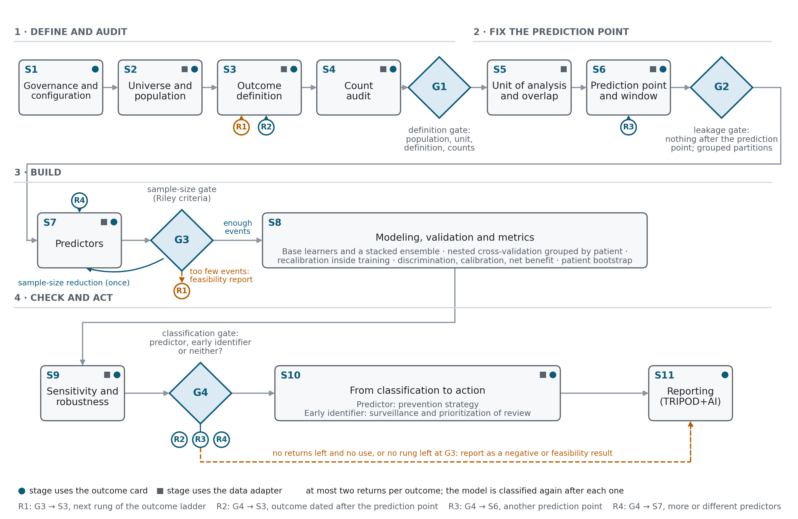

# Framework por etapas para modelos de predicción clínica

**Framework para la construcción de modelos predictivos en muertes maternas, perinatales y neonatales que apoyen la formulación de estrategias de prevención y planes de acción en entidades de salud.**

Tesis doctoral, Departamento de Ingeniería de Sistemas, Universidad del Norte (Barranquilla, Colombia). Autor: Emmanuel Gutiérrez Jiménez. Director: José Duván Márquez Díaz.

Versión en inglés: [`README.md`](README.md). Modelos que aplican el framework y su estado: [`models_es.md`](models_es.md).

> **Nomenclatura.** En español las etapas son **E1 a E11** y las puertas **P1 a P4**; en inglés son **S1 a S11** (*stages*) y **G1 a G4** (*gates*). Los retornos son **R1 a R4** y los criterios de clasificación **C1 a C4** en ambos idiomas.

## 1. Qué problema resuelve

Un modelo con buena discriminación no necesariamente predice. Cuando el desenlace se registra para toda una hospitalización (por ejemplo, con códigos de egreso), un modelo puede obtener un AUROC alto porque **reconoce un evento que ya está ocurriendo** en el momento de la predicción, y no porque lo anticipe. Ese modelo no sirve para prevenir. También puede ocurrir que el desenlace tenga tan pocos eventos que cualquier modelo quede sobreajustado, o que información posterior al momento de la predicción se cuele en los predictores (fuga de información).

El framework lleva cualquier desenlace adverso (materno, perinatal o neonatal) desde su definición hasta el reporte, con decisiones explícitas y **puertas** que detienen el proceso hasta que se cumplen sus criterios. Termina clasificando el modelo ajustado como:

- **Predictor:** anticipa eventos que todavía no han ocurrido. Sirve para **prevención**.
- **Identificador temprano:** reconoce eventos que ya están en curso. Sirve para **vigilancia y priorización de la revisión**, no para prevenir.
- **Señal insuficiente:** no alcanza los umbrales para un uso justificable (en la figura y en el artículo de Cureus, *neither*).

*Figura. Once etapas en cuatro bloques y cuatro puertas (en la figura, en inglés: S = etapa, G = puerta). Un punto marca las etapas que usan la ficha del desenlace y un cuadrado las que usan el adaptador de datos. R1 sale de la puerta de tamaño de muestra; R2 a R4 salen de la puerta de clasificación. La reducción por tamaño de muestra reajusta una vez un modelo que cumple la clasificación pero no el tamaño de muestra.*

## 2. Tres capas

El framework separa lo que nunca cambia de lo que depende del desenlace o de la fuente de datos. Así, un desenlace nuevo o una base de datos nueva no obligan a rehacer el método.

| Capa | Qué contiene | Cuándo cambia |
|---|---|---|
| **Núcleo** | Etapas, puertas, validación, métricas, regla de clasificación, reporte | Nunca entre desenlaces |
| **Ficha del desenlace** | Peldaño en la escalera de desenlaces, población, definición y momento del evento, punto de predicción, predictores, conjunto reducido de predictores, modelo principal, análisis de sensibilidad, conteos esperados | Cada desenlace tiene su ficha |
| **Adaptador de datos** | Código que convierte una fuente de datos en la **tabla contrato** | Cada fuente de datos tiene su adaptador |

**Tabla contrato.** El núcleo solo lee una tabla con una fila por unidad de análisis y columnas fijas: `unit_id`, `group_id` (unidad de agrupación que nunca se divide entre entrenamiento y prueba, por ejemplo la paciente), `t0` (tiempo cero), `t_pred` (punto de predicción), la etiqueta principal y las de sensibilidad, cada predictor con un indicador de si se midió, y `period` (período calendario o era de codificación).

**Libro de decisiones.** Cada decisión se registra con su fecha, las opciones consideradas, la opción elegida, la razón, el tipo de razón (clínica, metodológica o técnica) y quién la validó. No es una etapa: acompaña todo el recorrido y permite auditar cada elección.

## 3. Recorrido general

| Bloque | Etapa o puerta | Pregunta que responde |
|---|---|---|
| Definir y auditar | E1 Gobierno y configuración | ¿Qué se fija antes de correr nada? |
| | E2 Universo y población | ¿Qué unidades se pueden estudiar? |
| | E3 Definición del desenlace | ¿Qué cuenta como evento, de qué fuentes y cuándo ocurrió? |
| | E4 Auditoría de conteos | ¿Cuántos eventos hay, dónde, cuándo y con qué solapamiento? |
| | **P1 Puerta de definición** | ¿Están fijos la población, la unidad y la definición, y se reproducen los conteos? |
| Fijar el punto de predicción | E5 Unidad de análisis y solapamiento | ¿Qué es un registro y qué debe quedar en un solo lado de una partición? |
| | E6 Punto de predicción y ventana | ¿Cuándo se predice y qué información puede usarse? |
| | **P2 Puerta de fuga** | ¿No entra nada posterior al punto de predicción y las particiones están agrupadas? |
| Construir | E7 Predictores | ¿Qué variables, con qué cobertura y límites? |
| | **P3 Puerta de tamaño de muestra** | ¿Hay eventos suficientes para los parámetros candidatos? |
| | E8 Modelado, validación y métricas | ¿Qué tan bien funciona y con qué incertidumbre? |
| Verificar y actuar | E9 Sensibilidad y robustez | ¿Resiste otras decisiones razonables, incluidos los criterios C1 a C4? |
| | **P4 Puerta de clasificación** | ¿Predictor, identificador temprano o señal insuficiente? |
| | E10 De la clasificación a la acción | ¿Qué uso corresponde a la clase y es justo entre subgrupos? |
| | E11 Reporte | ¿Qué se entrega y cómo? |

**Regla central: no se ajusta ningún modelo antes de pasar la puerta P3.** Todo lo que define el problema (población, desenlace, punto de predicción, predictores) se fija antes de ver un solo resultado de desempeño, para que esas decisiones no se acomoden a los resultados [1–3].

## 4. Las etapas

### E1. Gobierno y configuración

- **Qué se hace.** Se fijan la fuente de datos y su versión, el acceso y el acuerdo de uso, la semilla aleatoria, las versiones del software, los conteos de referencia que deben reproducirse y la regla de publicación (solo salidas agregadas, sin identificadores, celdas pequeñas suprimidas).
- **Por qué.** Un análisis que no se puede reproducir no se puede auditar. Fijar la configuración antes de correr evita que una decisión técnica cambie los resultados sin quedar registrada. La protección de la confidencialidad es una condición de los acuerdos de uso de datos de salud.
- **Literatura.** TRIPOD+AI pide declarar la fuente, las fechas y el software [1].

### E2. Universo y población

- **Qué se hace.** Se define el universo (todas las unidades que podrían estudiarse) y la población del modelo (las que cumplen los criterios de inclusión), y se cuenta cuántas unidades y eventos se pierden en cada exclusión.
- **Por qué.** La población determina a quién se le podrá aplicar el modelo. Un filtro mal elegido puede excluir justamente a los casos con el evento. Medir cada regla antes de aplicarla permite ver su efecto.
- **Literatura.** PROBAST evalúa el riesgo de sesgo en el dominio de participantes: fuentes de datos y criterios de inclusión apropiados [2].

### E3. Definición del desenlace

- **Qué se hace.** Se define qué cuenta como evento: catálogo verificado de códigos con su título, nivel (estricto, parcial, excluido), fuente y fecha de verificación; una etiqueta principal y etiquetas de sensibilidad como columnas; y, cuando se puede, **el momento en que ocurrió el evento** respecto al punto de predicción.
- **Por qué.** En bases administrativas la etiqueta es un **proxy** (un código, no el evento clínico verificado). Hay que documentarla para que sus límites queden a la vista. Saber cuándo ocurrió el evento es lo que después permite distinguir un predictor de un identificador temprano.
- **Literatura.** PROBAST, dominio del desenlace: definición predeterminada, estándar y sin incorporar información de los predictores [2].

### E4. Auditoría de conteos

- **Qué se hace.** Antes de cualquier modelo se cuentan los eventos por definición, período, era de codificación y subgrupo; el solapamiento de pacientes (varias admisiones de una misma persona); y la disponibilidad de la información en el momento de la predicción. Los conteos que dependen del desenlace se limitan a los que deciden si el modelo es posible; las frecuencias de cada predictor se calculan en toda la población, nunca separadas por desenlace.
- **Por qué.** "Auditar antes de modelar": los conteos revelan si hay eventos suficientes, si la etiqueta cambia con la codificación y si la información existe en el momento correcto. Separar las frecuencias por desenlace llevaría a elegir predictores por su asociación con el evento, lo que infla el desempeño.
- **Literatura.** Elegir predictores por su asociación univariada con el desenlace produce sobreajuste y optimismo [3, 4].

### E5. Unidad de análisis y solapamiento

- **Qué se hace.** Se define qué es un registro (por ejemplo, una hospitalización de parto o un nacimiento) y cuál es la unidad de agrupación (por ejemplo, la paciente) que nunca se divide entre entrenamiento y prueba.
- **Por qué.** Si una misma paciente aparece en entrenamiento y en prueba, el modelo puede reconocerla a ella en lugar de aprender el patrón, y el desempeño estimado es optimista.
- **Literatura.** La validación por registro en lugar de por sujeto sobrestima el desempeño [5].

### E6. Punto de predicción y ventana de información

- **Qué se hace.** Se fija el tiempo cero, el momento en que se hace la predicción y qué información puede usarse: solo la registrada hasta ese momento. Se decide antes que los predictores.
- **Por qué.** El punto de predicción define la pregunta clínica (¿qué se sabe y cuándo?) y la utilidad del modelo: un modelo que predice al ingreso sirve para algo distinto que uno que predice al egreso. Fijarlo primero impide que la elección de predictores lo mueva.
- **Literatura.** TRIPOD+AI exige declarar el momento de la predicción y el horizonte [1]; el análisis *landmark* define la población en riesgo en ese momento [6].

### E7. Predictores

- **Qué se hace.** Se eligen los predictores con razones clínicas y con su cobertura en toda la población; se fijan límites de plausibilidad, la codificación de categorías, el tratamiento de los faltantes, el número de parámetros candidatos y un **conjunto reducido** de predictores por reglas, para usarlo si la puerta P3 lo exige.
- **Por qué.** El número de parámetros determina cuántos eventos se necesitan (P3). Un faltante en datos clínicos no es aleatorio (refleja a quién se le hizo un examen), así que su tratamiento se decide y documenta.
- **Literatura.** Los indicadores de faltante y los exámenes solicitados reflejan el proceso de atención y pueden sesgar el modelo [7]; tamaño de muestra según parámetros [8, 9].

### E8. Modelado, validación y métricas

- **Qué se hace.** Validación cruzada anidada y agrupada por la unidad de agrupación, con imputación, escalado, búsqueda de hiperparámetros, apilamiento y recalibración ajustados solo dentro de la parte de entrenamiento; intervalos de confianza por bootstrap de pacientes. Se reportan discriminación (AUROC, AUPRC frente a la prevalencia), calibración (pendiente, intercepto, razón observados/esperados) y utilidad clínica (proporción de eventos en el 5% y 10% de mayor riesgo, curva de decisión).
- **Por qué.** La validación anidada evita que la búsqueda de hiperparámetros contamine la estimación del desempeño. La calibración importa tanto como la discriminación: un modelo que ordena bien pero da riesgos equivocados lleva a malas decisiones. El modelo principal se fija antes según los eventos por parámetro, porque los modelos flexibles necesitan muchos más eventos que la regresión. No se corrige el desbalance de clases en el análisis principal porque esas correcciones dañan la calibración.
- **Literatura.** Validación anidada [10]; calibración [11, 12]; curva de decisión [13]; los métodos flexibles necesitan más datos [14]; daño de las correcciones de desbalance [15]; apilamiento [16].

### E9. Sensibilidad y robustez

- **Qué se hace.** Se repite el análisis con otras decisiones razonables (definiciones del desenlace, poblaciones, ventanas) y se corren los análisis preespecificados de los criterios C1 a C4 que usa la puerta P4.
- **Por qué.** Un resultado que depende de una sola decisión arbitraria no es confiable. Preespecificar los análisis evita escoger después el que da mejor resultado.
- **Literatura.** Riesgo de los múltiples caminos analíticos no preespecificados [17].

### E10. De la clasificación a la acción

- **Qué se hace.** Se traduce la clase del modelo a un uso concreto (prevención si es predictor; vigilancia y priorización si es identificador temprano), se estima la carga de trabajo (cuántas alertas por cada caso encontrado) y se evalúa el desempeño por subgrupos (por ejemplo, raza y etnia, tipo de seguro).
- **Por qué.** El objetivo de la tesis es apoyar estrategias de prevención y planes de acción en entidades de salud: un modelo solo es útil si se sabe qué hacer con su resultado. Un modelo puede funcionar peor en algunos grupos y reproducir inequidades.
- **Literatura.** Sesgo de algoritmos que reproduce inequidades [18]; utilidad clínica con curvas de decisión [13].

### E11. Reporte

- **Qué se hace.** Se entrega el reporte completo según TRIPOD+AI, con las salidas agregadas, el código, la ficha del desenlace y el libro de decisiones. Si el proceso se detuvo en una puerta, se reporta como **análisis de factibilidad** o **resultado negativo**.
- **Por qué.** Los resultados negativos y las razones por las que un desenlace no se pudo modelar son información útil; ocultarlos sesga la literatura.
- **Literatura.** TRIPOD+AI [1].

## 5. Las puertas: qué verifican, cuándo se pasan y por qué ese criterio

### P1. Puerta de definición

| Aspecto | Contenido |
|---|---|
| Verifica | Que la población, la unidad de análisis y la definición del evento estén fijas, y que los conteos de referencia se reproduzcan |
| Indicadores para pasar | Los conteos de referencia de la auditoría (unidades, pacientes, eventos por definición) coinciden exactamente al reconstruir las tablas; una verificación automática (`EXPECTED`) detiene cualquier corrida cuya población no sea la auditada |
| Si no pasa | Se vuelve a E2 o E3 hasta que la definición sea estable |
| Por qué este criterio | Si la población o la etiqueta cambian entre corridas, los resultados no son comparables y cualquier ajuste posterior puede estar acomodándose a los datos. La reproducción exacta es la prueba más simple de que la definición quedó fija [1, 2] |

### P2. Puerta de fuga

| Aspecto | Contenido |
|---|---|
| Verifica | Que ninguna información posterior al punto de predicción entre al modelo y que toda partición esté agrupada |
| Indicadores para pasar | (1) Ningún predictor tiene fecha posterior al punto de predicción ni proviene del mismo episodio que el desenlace (diagnósticos, procedimientos, códigos DRG o tratamientos de la misma admisión); (2) ninguna unidad de agrupación aparece en entrenamiento y prueba a la vez; (3) imputación, escalado, búsqueda de hiperparámetros, apilamiento y recalibración se ajustan solo con datos de entrenamiento; (4) **señal del formulario en los desconocidos:** se reporta el AUROC del número de campos desconocidos por sí solo; si separa los eventos claramente mejor que el azar, los desconocidos llevan información del proceso de registro y su tratamiento debe impedir que el modelo la aprenda; (5) **imputación cuando los desconocidos difieren entre formularios o fuentes:** se comparan en las mismas particiones la imputación por la mediana, el sorteo aleatorio de los valores observados (ponderado a la población), la mediana con indicadores de faltante (cota superior de la fuga) y el manejo nativo, junto con qué tan bien los datos imputados delatan qué registro tenía un desconocido; si el sorteo queda más de 0,005 por debajo de la mediana con su IC 95% por debajo de 0, la mediana lleva la señal del formulario y la imputación es el **sorteo aleatorio** (solo registros completos como alternativa). Las condiciones (4) y (5) se agregaron después de los modelos M5 y M6 (monografía, secciones 5.3.2 y 9.3) |
| Si no pasa | Se retiran los predictores con fuga, se corrige la partición o se cambia el tratamiento de los desconocidos (sorteo aleatorio, o solo registros completos); no se continúa hasta cumplirse |
| Por qué este criterio | La fuga de información es una de las causas más frecuentes de desempeño inflado e irreproducible en aprendizaje automático [19, 20]; las particiones por registro en lugar de por paciente sobrestiman el desempeño [5]. En M5 ningún predictor era posterior al punto de predicción, pero la imputación por la mediana dejaba pasar el tipo de formulario (reporte de muerte fetal o certificado de nacimiento): con los datos imputados se podía saber qué registro tenía un desconocido con un AUROC de 0,913, y el AUROC bajó de 0,7455 a 0,723 con el sorteo aleatorio. M6 se construyó para comprobarlo (ver [`models_es.md`](models_es.md)) |

### P3. Puerta de tamaño de muestra

| Aspecto | Contenido |
|---|---|
| Verifica | Que haya unidades y eventos suficientes para el número de parámetros candidatos |
| Indicadores para pasar | Con los criterios de Riley et al. [8, 9], en dos pasos: **planeación**, antes de ajustar cualquier modelo candidato, con un R² de Cox-Snell supuesto del 15% de su máximo; y **reevaluación** con el **R² de Cox-Snell observado** de una regresión logística penalizada calculado con sus predicciones fuera de muestra (no es un valor aparente). Se reportan los dos. Los parámetros candidatos son las columnas después de la codificación *one-hot*, sin el intercepto; los criterios son un mínimo para los algoritmos flexibles, que necesitan más eventos por parámetro que la regresión [14]. el tamaño mínimo es el mayor de tres: (1) encogimiento esperado de 0,9 o más; (2) diferencia de 0,05 o menos entre el R² de Nagelkerke aparente y el ajustado; (3) riesgo global estimado con un margen de ±0,05. **Pasa si las unidades y los eventos disponibles igualan o superan ese mínimo.** También se reporta el número máximo de parámetros que soportan los datos |
| Si no pasa | El desenlace se reporta como análisis de factibilidad y el retorno R1 lleva al siguiente peldaño de la escalera de desenlaces. Si el modelo ya cumplió la puerta P4, se permite una vez la **reducción por tamaño de muestra** (abajo) |
| Por qué este criterio | La regla tradicional de 10 eventos por variable no tiene base sólida [21]. Los criterios de Riley et al. calculan el tamaño necesario a partir de la prevalencia, el número de parámetros y la variación explicada, y son la referencia actual para desarrollar modelos de predicción [8, 9]. Usar el R² observado en validación cruzada, y no uno supuesto, ancla el cálculo a los datos reales sin mirar el AUROC |

**Reducción por tamaño de muestra.** Si un modelo cumple todos los criterios aplicables de la puerta P4 pero no pasa la P3, se puede reajustar **una sola vez** con el conjunto reducido de predictores fijado en la ficha (por reglas: colapsar categorías, conservar las variables clínicas centrales), sin superar los parámetros que soportan los datos y **nunca** eligiendo predictores por su asociación con el desenlace. El modelo reducido debe pasar la P3 y se clasifica de nuevo en la P4 con los mismos umbrales. No cuenta como retorno. Su razón: un modelo con señal real no debe descartarse solo por tener demasiados parámetros, pero reducirlo mirando los resultados sería sobreajuste encubierto [3, 4].

### P4. Puerta de clasificación

Cuatro criterios, cada uno probado con un análisis de sensibilidad preespecificado. Los umbrales se fijan antes de ver los resultados.

| Criterio | Pregunta | Indicador y umbral para cumplirlo | Por qué este criterio |
|---|---|---|---|
| **C1** Eventos ya presentes | ¿Cuánto cae el desempeño al retirar los eventos que ya estaban presentes en el punto de predicción (población *landmark*)? | El AUROC cae **0,05 o menos**. La proporción conservada de la ganancia del AUPRC sobre la prevalencia se reporta, pero no decide | Un modelo que predice no debe depender de casos que ya ocurrieron; la población *landmark* es la población realmente en riesgo en el punto de predicción [6]. El AUPRC depende de la prevalencia, que cae al retirar los eventos presentes; el AUROC no. El umbral de 0,05 es una convención de este framework |
| **C2** Desenlace con tiempo | ¿Se mantiene el desempeño para eventos fechados después del punto de predicción? | AUROC de **0,75 o más**, con límite inferior del IC 95% de **0,70 o más** | Solo un evento posterior al punto de predicción se puede prevenir. 0,70 y 0,80 son las convenciones habituales de discriminación aceptable y buena [22]; 0,75 es el punto medio y el límite inferior de 0,70 exige que el resultado no dependa del azar |
| **C3** Sesgo de detección | Cuando el desenlace depende de un examen, ¿se mantiene el desempeño entre las pacientes a las que se les hizo? | El AUROC cae **0,05 o menos** | Los exámenes se piden porque el clínico ya sospecha algo: el hecho de que exista un examen lleva información del estado de la paciente, y un desenlace definido por un examen solo se detecta en quien fue examinada [7] |
| **C4** Estabilidad en el tiempo | ¿Discrimina y calibra en un período posterior? | AUROC temporal de **0,70 o más** y pendiente de calibración temporal entre **0,90 y 1,10** (estimación puntual), de modo que la calibración se corrija solo con el intercepto | La práctica clínica, la codificación y la mezcla de casos cambian con el tiempo; la validación temporal es el paso intermedio entre la validación interna y la externa [11, 12, 23] La pendiente se juzga con una banda de tolerancia y no según si su IC 95% incluye 1: con cientos de miles de unidades el IC es tan estrecho que una desviación despreciable (por ejemplo 0,98) no pasa, mientras que con pocas unidades un IC amplio acepta casi cualquier pendiente. El límite inferior 0,90 es el encogimiento que Riley et al. aceptan como tolerable [8]; 1,10 es su simétrico |

Un criterio que no puede aplicarse a un desenlace (por ejemplo C3 cuando el desenlace no depende de un examen) se marca **no aplica** en la ficha, con su razón, antes de ajustar cualquier modelo.

**Modelo ajustado y tamaño de muestra.** Un criterio que pregunta cómo se comporta un modelo en una parte de su población (C1, población *landmark*; C2, desenlace fechado después del punto de predicción) se evalúa sobre **el modelo ajustado una sola vez en toda su población**, restringiendo sus predicciones fuera de muestra al subconjunto; el modelo no se vuelve a ajustar allí. Todo conjunto en el que se ajusta un modelo, incluido el período de desarrollo de la validación temporal (C4), debe pasar la puerta P3; si no, el criterio se reporta como **no evaluable**. Toda cantidad de decisión se reporta con su intervalo de 95%.

**Regla de clasificación:**

| Clase | Condición | Uso |
|---|---|---|
| **Predictor** | AUROC de 0,75 o más en la población *landmark* o en un desenlace con tiempo, y cumple C1 a C4 | Estrategia de prevención |
| **Identificador temprano** | AUROC de 0,75 o más con la etiqueta completa y el 10% de mayor riesgo concentra al menos el doble de los eventos esperados por azar, pero falla C1, C3 o C4 | Vigilancia y priorización de la revisión |
| **Señal insuficiente** (*neither*) | En otro caso, o con AUROC temporal menor de 0,65 | Sin uso; se reporta |

El umbral de "el doble de los eventos esperados en el 10% de mayor riesgo" y el de AUROC temporal menor de 0,65 son convenciones de este framework, elegidas para que la clase "identificador temprano" exija una utilidad mínima para priorizar y para descartar modelos que pierden la discriminación con el tiempo.

## 6. Retornos y escalera de desenlaces

Cuando un modelo no queda como predictor, el framework permite otro enfoque antes de reportar:

| Retorno | Sale de | Vuelve a | Qué cambia |
|---|---|---|---|
| R1 | P3 | E3 | Siguiente peldaño de la escalera de desenlaces |
| R2 | P4 | E3 | Un desenlace fechado después del punto de predicción |
| R3 | P4 | E6 | Otro punto de predicción |
| R4 | P4 | E7 | Más predictores o predictores distintos |

**Como máximo dos retornos por desenlace**; cada retorno se reporta y el modelo se clasifica de nuevo después de cada uno. Sin retornos disponibles, el resultado va a E11 como resultado negativo o de factibilidad. El límite existe porque cada intento adicional aumenta la probabilidad de encontrar un resultado favorable por azar [17].

**Modelo derivado.** Como R1 cambia el desenlace (otro peldaño de la escalera), el modelo que resulta es un **modelo derivado**: tiene su propia ficha del desenlace, recorre de nuevo las puertas y dispone de sus propios dos retornos. En el catálogo, el modelo de origen se registra como **exploratorio** ("no pasa P3; deriva en M*n* por R1") y el derivado indica su origen. Los retornos R2 a R4 no crean un modelo nuevo: cambian el mismo desenlace y cuentan dentro de su límite. Un **modelo de verificación** es distinto: se construye para comprobar un hallazgo de otro modelo (por ejemplo, una señal de fuga detectada en P2) y no consume retornos del modelo verificado.

**Escalera de desenlaces** (tres peldaños): (1) el desenlace ideal (por ejemplo, la muerte materna); (2) un sustituto más frecuente en la misma ruta clínica (por ejemplo, la morbilidad materna grave); (3) un desenlace fechado después del punto de predicción (por ejemplo, el escalamiento de la atención).

## 7. Reglas de modelado (E8)

- Validación cruzada anidada agrupada por paciente: 5 pliegues externos × 3 repeticiones, pliegues internos agrupados; recalibración de Platt dentro del entrenamiento; intervalos por bootstrap de pacientes [10].
- Modelos base: regresión logística penalizada, bosque aleatorio, árboles extra y XGBoost; ensamble apilado con meta-aprendiz logístico como comparación, adoptado solo si supera de forma consistente al mejor modelo base [16].
- **Modelo principal según eventos por parámetro** (pendiente de validación del director): con menos de 20 eventos por parámetro candidato, la regresión logística penalizada es el modelo principal; con 20 o más, el mejor modelo base de una corrida preliminar [14].
- Sin remuestreo en el análisis principal; pesos de clase y remuestreo solo como sensibilidad [15].
- Imputación dentro del entrenamiento. Cuando los desconocidos difieren entre formularios o fuentes, la imputación se elige con la condición (5) de la puerta P2 (sorteo aleatorio de los valores observados si la mediana lleva la señal del formulario); los indicadores de faltante solo como cota superior de la fuga, nunca en el modelo que se clasifica.

## 8. Principios que no cambian

1. Auditar antes de modelar.
2. Las reglas se miden primero como columnas y después se aplican como filtros, cada una con su análisis de sensibilidad.
3. La etiqueta es un proxy documentado.
4. El punto de predicción y la ventana se fijan antes que los predictores.
5. Cada decisión es una decisión numerada en el libro de decisiones.
6. Solo salidas agregadas; celdas pequeñas suprimidas; ningún identificador en los archivos publicados.
7. Código y documentos en pares EN/ES con código idéntico, configuración fija, reporte TRIPOD+AI.

## 9. Qué es literatura y qué es convención propia

Para que el framework sea auditable, se separa lo que viene de la literatura de lo que se fijó en esta tesis:

| Elemento | Origen |
|---|---|
| Criterios de tamaño de muestra (encogimiento 0,9, optimismo 0,05, margen ±0,05) | Riley et al. [8, 9] |
| Población *landmark* para C1 | van Houwelingen [6] |
| AUROC 0,70 aceptable y 0,80 buena (base del umbral de 0,75) | Hosmer, Lemeshow y Sturdivant [22] |
| Calibración y su corrección por el intercepto | Van Calster et al. [11, 12] |
| Validación temporal para C4 | Justice et al. [23]; Steyerberg [3] |
| Caída máxima de 0,05 en C1 y C3; doble de eventos en el 10% superior; banda de 0,90–1,10 para la pendiente en C4 (su límite inferior retoma el encogimiento de 0,9 de Riley [8]); AUROC temporal menor de 0,65 para "señal insuficiente"; máximo dos retornos; reducción por tamaño de muestra; umbral de 20 eventos por parámetro; en P2, imputación por sorteo aleatorio cuando la mediana lleva la señal del formulario (caída de más de 0,005 con su IC por debajo de 0) | Convenciones de este framework, registradas en el libro de decisiones |

## 10. Modelos que aplican el framework

El catálogo de todos los modelos ideados, incluidos los que no pasaron alguna puerta, con el enlace a su repositorio y el estado de cada etapa y puerta, está en [`models_es.md`](models_es.md).

## Referencias

1. Collins GS, Moons KGM, Dhiman P, et al. TRIPOD+AI statement: updated guidance for reporting clinical prediction models that use regression or machine learning methods. BMJ. 2024;385:e078378.
2. Wolff RF, Moons KGM, Riley RD, et al. PROBAST: a tool to assess the risk of bias and applicability of prediction model studies. Ann Intern Med. 2019;170(1):51–58.
3. Steyerberg EW. Clinical Prediction Models: A Practical Approach to Development, Validation, and Updating. 2.ª ed. Cham: Springer; 2019.
4. Steyerberg EW, Vergouwe Y. Towards better clinical prediction models: seven steps for development and an ABCD for validation. Eur Heart J. 2014;35(29):1925–1931.
5. Saeb S, Lonini L, Jayaraman A, Mohr DC, Kording KP. The need to approximate the use-case in clinical machine learning. GigaScience. 2017;6(5):1–9.
6. van Houwelingen HC. Dynamic prediction by landmarking in event history analysis. Scand J Stat. 2007;34(1):70–85.
7. Agniel D, Kohane IS, Weber GM. Biases in electronic health record data due to processes within the healthcare system: retrospective observational study. BMJ. 2018;361:k1479.
8. Riley RD, Snell KI, Ensor J, et al. Minimum sample size for developing a multivariable prediction model: PART II — binary and time-to-event outcomes. Stat Med. 2019;38(7):1276–1296.
9. Riley RD, Ensor J, Snell KIE, et al. Calculating the sample size required for developing a clinical prediction model. BMJ. 2020;368:m441.
10. Varma S, Simon R. Bias in error estimation when using cross-validation for model selection. BMC Bioinformatics. 2006;7:91.
11. Van Calster B, McLernon DJ, van Smeden M, Wynants L, Steyerberg EW. Calibration: the Achilles heel of predictive analytics. BMC Med. 2019;17:230.
12. Van Calster B, Nieboer D, Vergouwe Y, De Cock B, Pencina MJ, Steyerberg EW. A calibration hierarchy for risk models was defined: from utopia to empirical data. J Clin Epidemiol. 2016;74:167–176.
13. Vickers AJ, Elkin EB. Decision curve analysis: a novel method for evaluating prediction models. Med Decis Making. 2006;26(6):565–574.
14. van der Ploeg T, Austin PC, Steyerberg EW. Modern modelling techniques are data hungry: a simulation study for predicting dichotomous endpoints. BMC Med Res Methodol. 2014;14:137.
15. van den Goorbergh R, van Smeden M, Timmerman D, Van Calster B. The harm of class imbalance corrections for risk prediction models: illustration and simulation using logistic regression. J Am Med Inform Assoc. 2022;29(9):1525–1534.
16. Wolpert DH. Stacked generalization. Neural Netw. 1992;5(2):241–259.
17. Gelman A, Loken E. The statistical crisis in science. Am Sci. 2014;102(6):460–465.
18. Obermeyer Z, Powers B, Vogeli C, Mullainathan S. Dissecting racial bias in an algorithm used to manage the health of populations. Science. 2019;366(6464):447–453.
19. Kaufman S, Rosset S, Perlich C, Stitelman O. Leakage in data mining: formulation, detection, and avoidance. ACM Trans Knowl Discov Data. 2012;6(4):15.
20. Kapoor S, Narayanan A. Leakage and the reproducibility crisis in machine-learning-based science. Patterns. 2023;4(9):100804.
21. van Smeden M, Moons KGM, de Groot JAH, et al. Sample size for binary logistic prediction models: beyond events per variable criteria. Stat Methods Med Res. 2019;28(8):2455–2474.
22. Hosmer DW, Lemeshow S, Sturdivant RX. Applied Logistic Regression. 3.ª ed. Hoboken: Wiley; 2013.
23. Justice AC, Covinsky KE, Berlin JA. Assessing the generalizability of prognostic information. Ann Intern Med. 1999;130(6):515–524.

*Las referencias deben cotejarse con las fuentes originales antes de citarlas en la monografía.*
